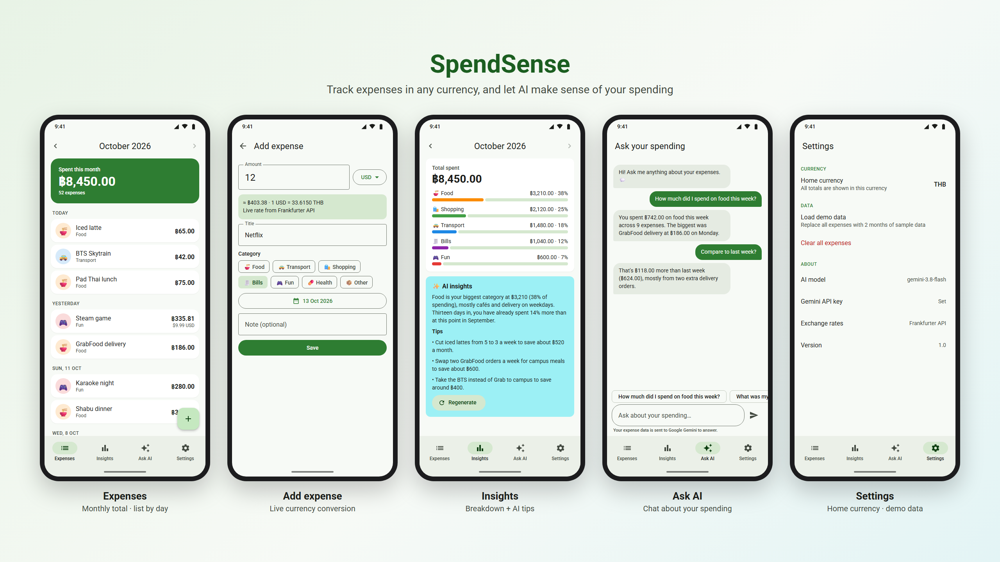
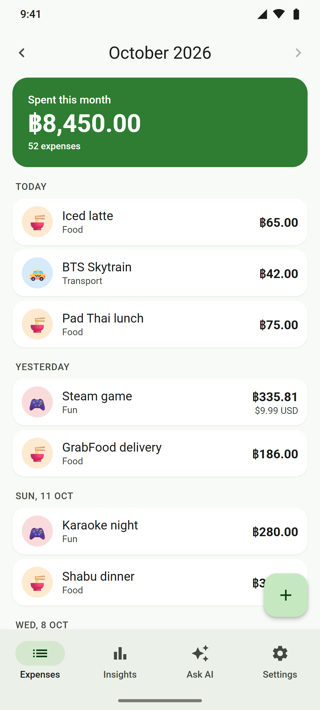
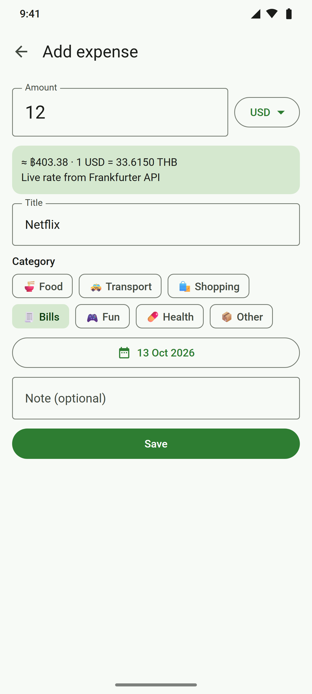
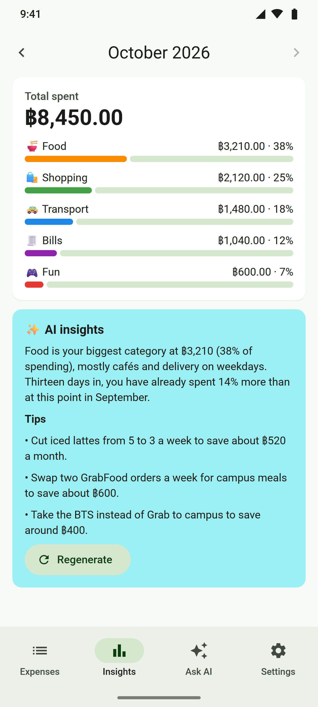
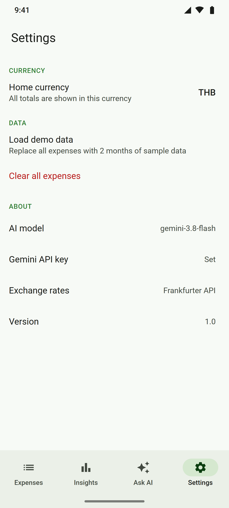

# SpendSense

An Android expense tracker that makes sense of your spending with AI.

Log expenses in any major currency. SpendSense converts them to your home currency at live
exchange rates, shows where your money goes by category, and uses Google Gemini to write a
monthly analysis with saving tips and to answer questions about your spending in a chat.



## Features

- **Expenses**: month-by-month list grouped by day, swipe to delete with Undo
- **Add / Edit**: any of ~30 currencies, converted live with the Frankfurter API
- **AI Insights**: category breakdown + Gemini summary and saving tips, saved per month
- **Ask AI**: chat about your own expenses ("How much did I spend on food this week?")
- **Settings**: home currency (re-converts all expenses), demo data, clear all

## Course requirements

| Requirement | How SpendSense meets it |
|---|---|
| Multiple screens | Expenses, Add/Edit Expense, Insights, Ask AI, Settings |
| Data persistence | Room (expenses, AI insights) + DataStore (home currency) |
| External API (coroutines) | Frankfurter exchange-rate API via Retrofit `suspend` functions |
| AI-integrated functions | Gemini monthly insights + "Ask your spending" chat |

## Tech stack

Kotlin · Jetpack Compose (Material 3) · Navigation Compose · MVVM + StateFlow · Coroutines ·
Room · DataStore · Retrofit + kotlinx.serialization · Gemini API (`gemini-3.8-flash`) · Frankfurter API

Architecture: Compose screens → ViewModels → repositories → Room / DataStore / Retrofit,
wired by hand in `AppContainer` (no DI framework).

## Setup

1. Open the project in Android Studio (2026.1 or newer) and let Gradle sync.
2. Get a free Gemini API key at https://aistudio.google.com/apikey.
3. Add it to `local.properties` (never commit this file):
   `GEMINI_API_KEY=your-key-here`
4. Run the app. In **Settings → Load demo data** to get two months of sample expenses.

Without a key the app still works; the AI screens show a "key missing" message.

## Screen design

| Expenses | Add expense | Insights | Ask AI | Settings |
|---|---|---|---|---|
|  |  |  |  |  |

The designs are rendered from `docs/mockups/app-screens.html` (`bash docs/mockups/render.sh`).

## Tests

```bash
./gradlew :app:testDebugUnitTest
```

61 unit tests cover money/date helpers, currency caching and errors, the AI prompt builder,
the Gemini repository, and the Add/Edit, Settings, Insights and Ask AI logic.
`ExpenseDaoTest` (Room) runs on a device with `./gradlew :app:connectedDebugAndroidTest`.

## Privacy

Your expenses are stored only on your device. When you use AI Insights or Ask AI,
the relevant expense data is sent to Google Gemini to produce the answer.
